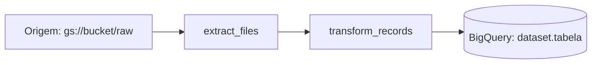

# Tour do código: `<módulo ou arquivo>`

> Gerado em <data> · Escopo: `<arquivos analisados>`

## 1. Mapa geral
**Propósito:** …

**Pontos de entrada:**
- `arquivo.py:linha`: …

**Peças principais:**
| Arquivo / símbolo | Papel |
|---|---|
| `x.py::Classe` | … |



## 2. Fluxo de dados
- **Origem:** …
- **Transformações:**
  1. `funcao_a`: …
  2. `funcao_b`: …
- **Destino / modo de escrita:** …
- **Configuração externa:** …

## 3. Função por função
#### `funcao(params)` (arquivo.py:00)
- **O que faz:**
- **Entrada → Saída:**
- **Efeitos colaterais:**
- **Como faz:**
  1. …
- **Por que assim:**

## 4. Trechos difíceis
### `arquivo.py:00-00`
```python
# trecho
```
Linha a linha:
- …

Exemplo: entrada `…` → saída `…`

## 5. Riscos e pontos de atenção
| Severidade | Onde | Problema | Sugestão |
|---|---|---|---|
| Alta | `x.py:10` | … | … |

## 6. Glossário e próximos passos
- **Termo:** definição.

Próximos passos:
1. …
